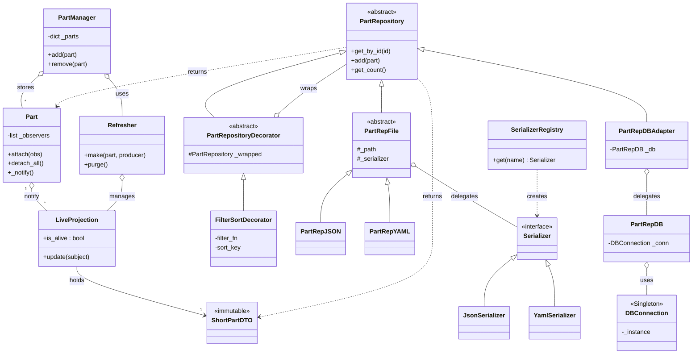
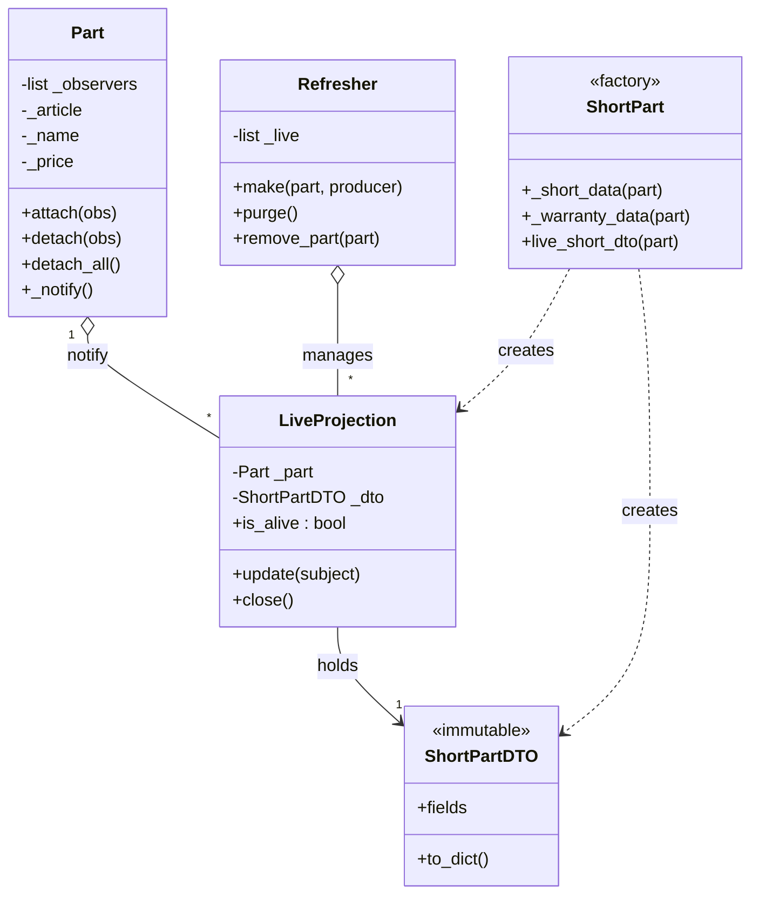
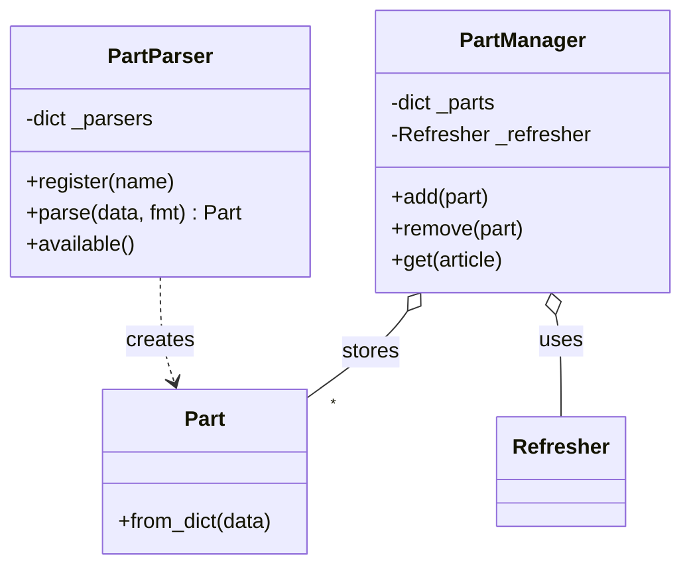
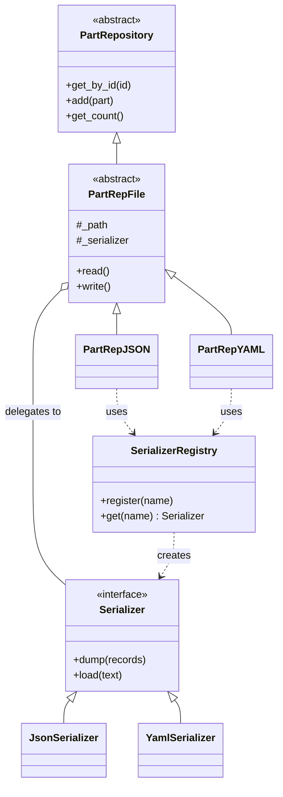
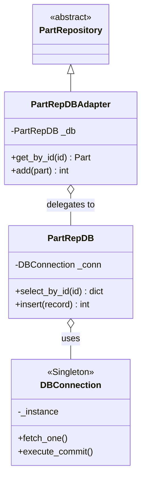
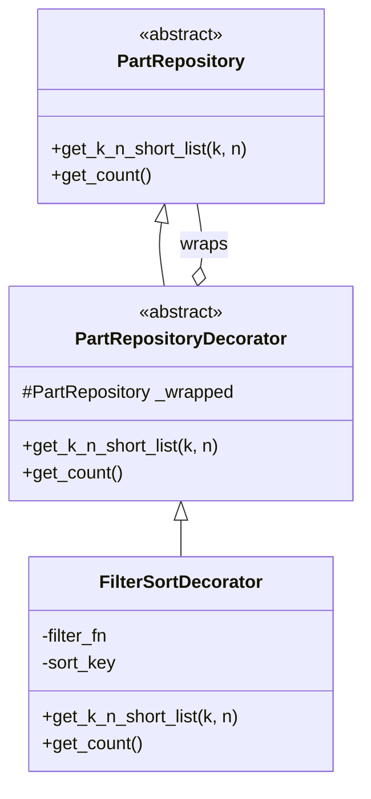

# Лабораторные работы №1 и №2 — Архитектура проекта

Данный документ содержит полную архитектуру проекта, разделенную по лабораторным работам и логическим веткам. Нажмите на название диаграммы, чтобы раскрыть её.

<b>🌟 ОБЩАЯ АРХИТЕКТУРА ПРОЕКТА (ЛР1 + ЛР2)</b> (нажмите, чтобы развернуть)

 
Здесь представлена полная картина взаимодействия всех компонентов. Видно, как доменная сущность `Part` (ЛР1) отделена от слоя хранения данных (`PartRepository`), а паттерны Observer, Strategy, Adapter, Singleton и Decorator гармонично дополняют друг друга.

## Лабораторная работа №1 (Домен и Observer)

<b>1. Ядро: Домен и живые проекции (Observer)</b> (нажмите, чтобы развернуть)

 
На этой диаграмме видно, как `Part` (Subject) уведомляет `LiveProjection` (Observer) об изменениях, а `Refresher` управляет их жизненным циклом.

<b>2. Вспомогательные ветки: Парсеры и Менеджер</b> (нажмите, чтобы развернуть)

 
Инструменты для создания объекта из разных форматов и in-memory репозиторий для демонстрации.

## Лабораторная работа №2 (Репозитории)

<b>1. Ветка работы с файлами (Стратегия и Реестр)</b> (нажмите, чтобы развернуть)

 
Показывает, как решается проблема дублирования кода между JSON и YAML. Вся логика в базовом `PartRepFile`, а формат вынесен в стратегии `Serializer`.

<b>2. Ветка работы с БД (Синглтон и Адаптер)</b> (нажмите, чтобы развернуть)

 
`DBConnection` (Синглтон) управляет единственным соединением. `PartRepDBAdapter` (Адаптер) встраивает SQL-репозиторий в общую иерархию.

<b>3. Ветка Декораторов (Фильтр и Сортировка)</b> (нажмите, чтобы развернуть)

 
Паттерн Декоратор позволяет добавить фильтрацию и сортировку поверх любого репозитория.

