# Лабораторные работы №1 и №2 — Архитектура проекта

Данный документ содержит полную архитектуру проекта, разделенную по лабораторным работам и логическим веткам. Нажмите на название диаграммы, чтобы раскрыть её.

<details>
<summary><b>🌟 СКВОЗНАЯ АРХИТЕКТУРА ПРОЕКТА (ЛР1 + ЛР2 + ЛР3)</b> (нажмите, чтобы развернуть)</summary>

<br>
Полная картина взаимодействия всех компонентов. В ЛР3 добавлен Real-Time слой (SSE + Database Triggers), который работает параллельно с MVC.

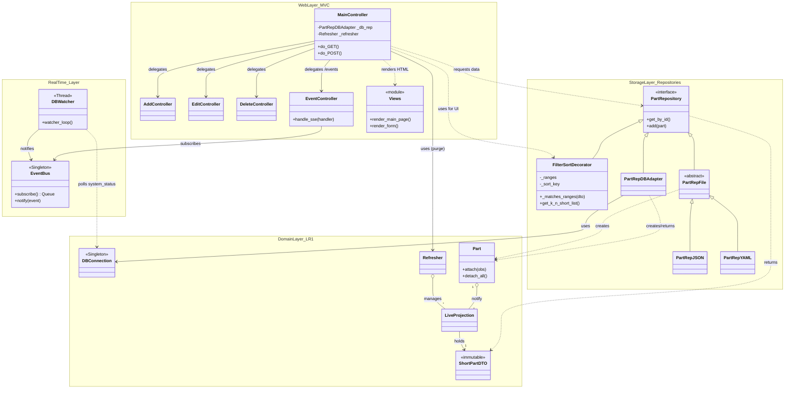
</details>

## Лабораторная работа №1 (Домен и Observer)

<details>
<summary><b>1. Ядро: Домен и живые проекции (Observer)</b> (нажмите, чтобы развернуть)</summary>

<br>
На этой диаграмме видно, как `Part` (Subject) уведомляет `LiveProjection` (Observer) об изменениях, а `Refresher` управляет их жизненным циклом.

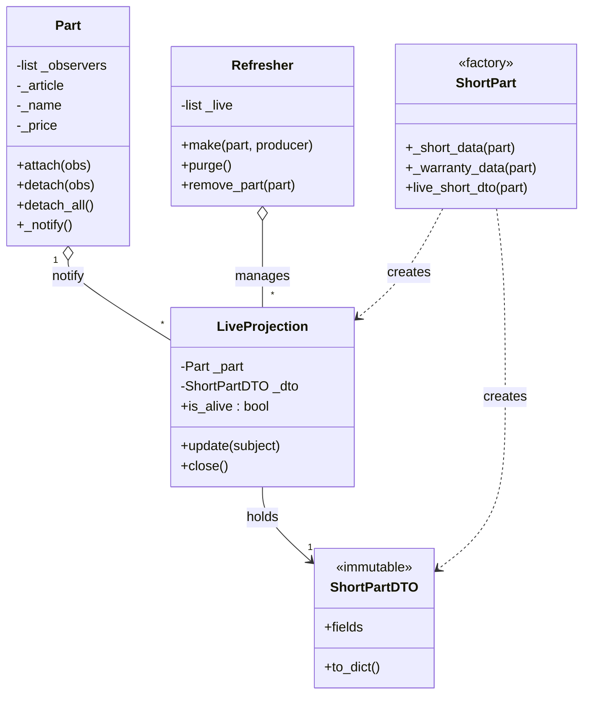

</details>

<details>
<summary><b>2. Вспомогательные ветки: Парсеры и Менеджер</b> (нажмите, чтобы развернуть)</summary>

<br>
Инструменты для создания объекта из разных форматов и in-memory репозиторий для демонстрации.

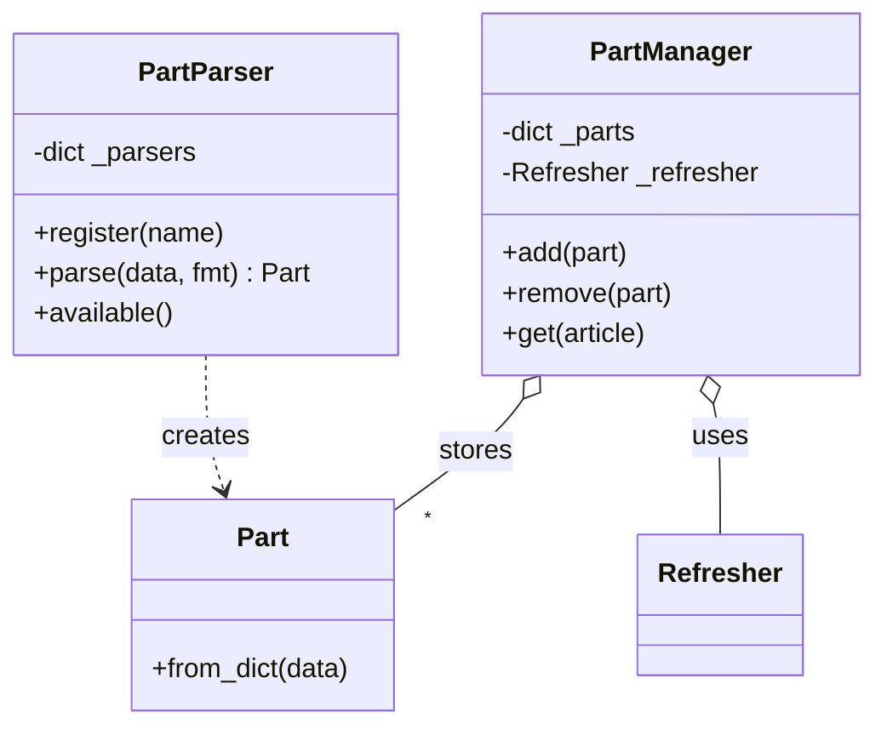

</details>

## Лабораторная работа №2 (Репозитории)

<details>
<summary><b>1. Ветка работы с файлами (Стратегия и Реестр)</b> (нажмите, чтобы развернуть)</summary>

<br>
Показывает, как решается проблема дублирования кода между JSON и YAML. Вся логика в базовом `PartRepFile`, а формат вынесен в стратегии `Serializer`.

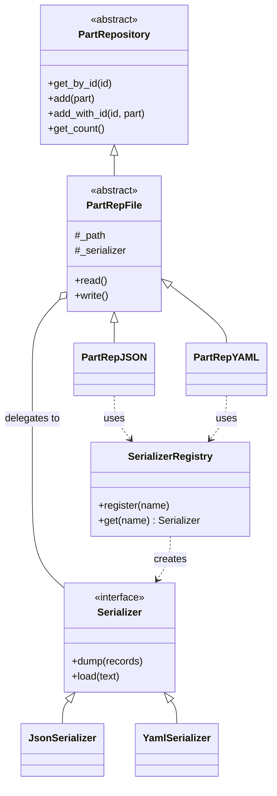

</details>

<details>
<summary><b>2. Ветка работы с БД (Синглтон и Адаптер)</b> (нажмите, чтобы развернуть)</summary>

<br>
`DBConnection` (Синглтон) управляет единственным соединением. `PartRepDBAdapter` (Адаптер) встраивает SQL-репозиторий в общую иерархию.

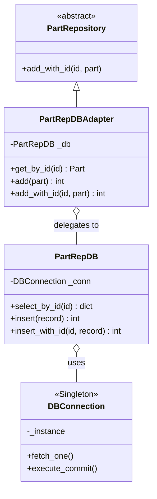

</details>

<details>
<summary><b>3. Ветка Декораторов (Фильтр и Сортировка)</b> (нажмите, чтобы развернуть)</summary>

<br>
Паттерн Декоратор позволяет добавить фильтрацию и сортировку поверх любого репозитория, не меняя код самого репозитория.

`FilterSortDecorator` поддерживает фильтр типа «Больше X, меньше Y»: вместо одной лямбды вызывающий код передает словарь `ranges` вида `{'id': ('10', '50'), 'price': ('2000', None)}`. Каждая граница приводится к числу (`_to_number`); пустое значение (`None` или `""`) означает отсутствие границы, поэтому незаполненное поле не сужает выборку. Если введено нечисловое значение, декоратор выбрасывает `ValueError`. Фильтрация по `filter_fn` и по `ranges` применяется совместно, затем результат сортируется по `sort_key` (если задан) и только после этого нарезается на страницу `k/n`.

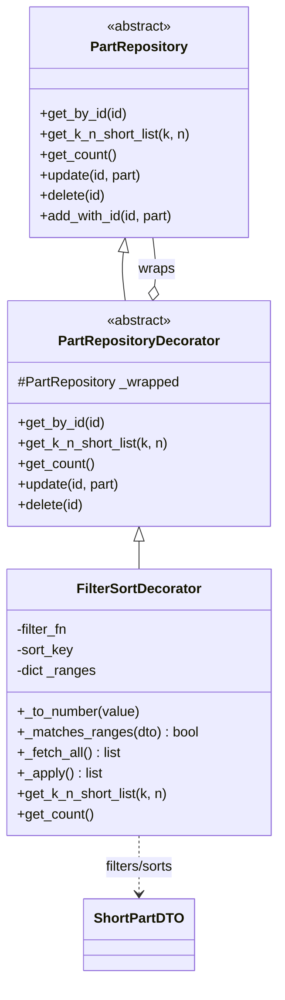

`ranges` хранит уже приведенные к `float` границы: `{field: (low, high)}`. Метод `_matches_ranges` проверяет, что значение поля DTO попадает в интервал, а `_apply` возвращает полный отфильтрованный и отсортированный список, из которого `get_k_n_short_list` и `get_count` уже берут нужный срез.

</details>

<details>
<summary><b>4. Ветка Компоновщика (Синхронизация хранилищ)</b> (нажмите, чтобы развернуть)</summary>

<br>
Паттерн Компоновщик (Composite) позволяет работать с группой репозиториев как с единым целым. В данном случае он берет ID из Primary (БД) и синхронизирует данные с репликами (файлами JSON/YAML).

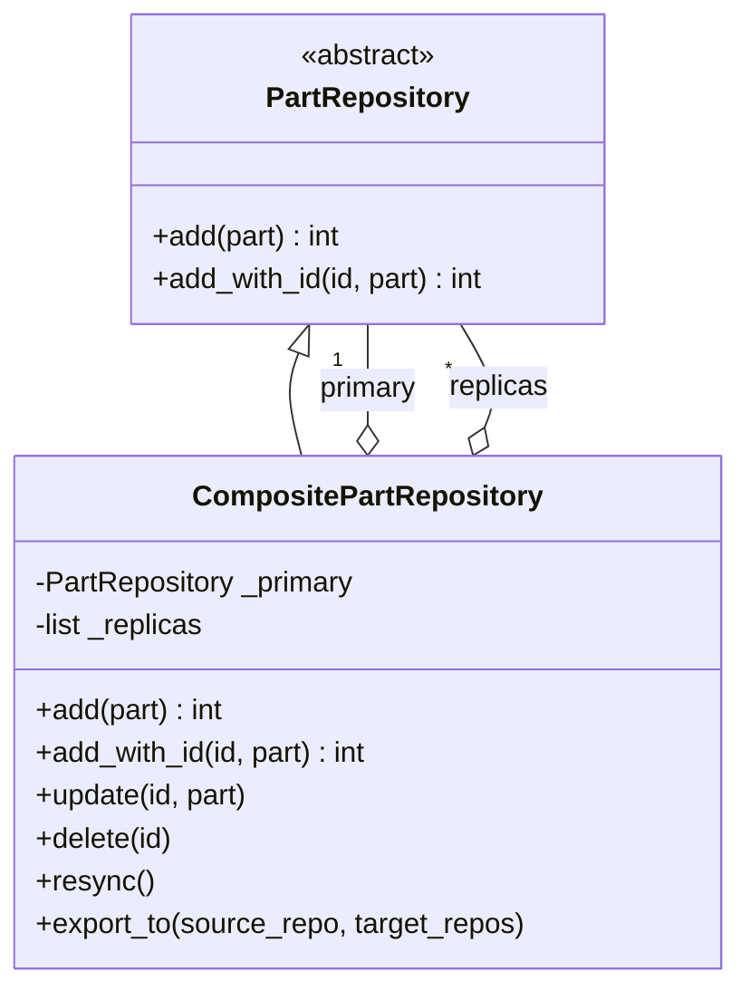

</details>

## Лабораторная работа №3 (MVC и Observer)</b>

### Диаграммы классов по пунктам:
<details>
<summary><b> Пункт 1: Базовый MVC + Read</b> (нажмите, чтобы развернуть)</summary>

<br>
На этой диаграмме показано разделение ответственности по паттерну MVC. Контроллер обрабатывает HTTP-запросы и связывает Представление (HTML-шаблоны) с Моделью (Репозиториями). Паттерн Наблюдатель используется на стороне Модели (через `Refresher`) для синхронизации данных.

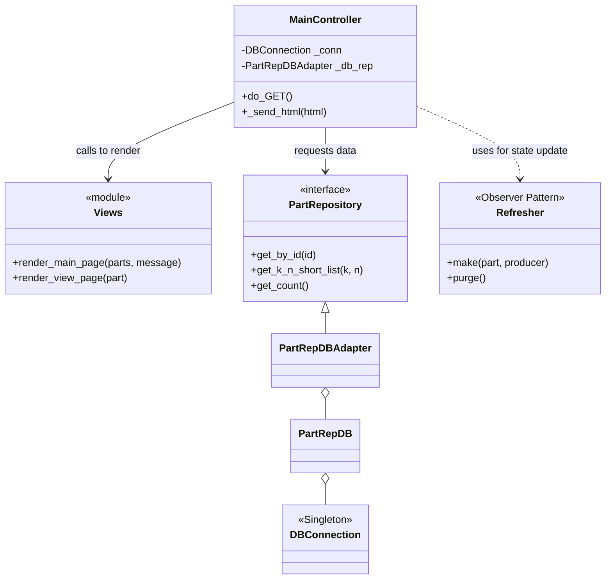
</details>

<details>
<summary><b> Пункт 2: Добавление записи</b> (нажмите, чтобы развернуть)</summary>

<br>
Для выполнения требования "для нового окна — новый контроллер" мы выделили `AddController`. Главный контроллер делегирует ему обработку маршрута `/add`.

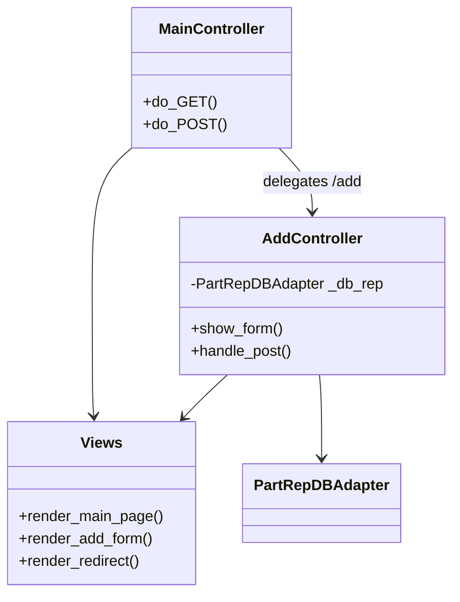
</details>

<details>
<summary><b> Пункт 3: Редактирование</b> (нажмите, чтобы развернуть)</summary>

<br>
По аналогии с добавлением создан `EditController`. Теперь `MainController` выступает как маршрутизатор, который передает управление нужному контроллеру в зависимости от URL.

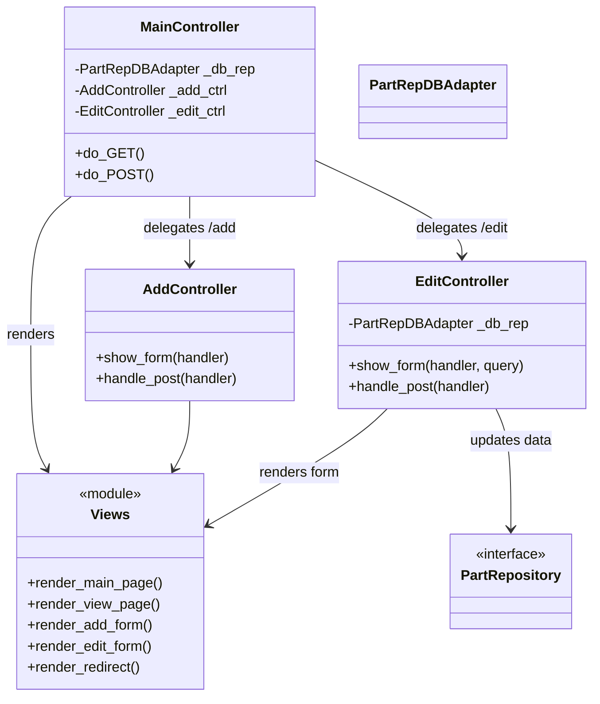
</details>

<details>
<summary><b> Пункт 4: Универсальная форма</b> (нажмите, чтобы развернуть)</summary>

<br>
Рефакторинг: вместо двух разных View-функций для добавления и редактирования, создана одна универсальная `render_form`. Различие в поведении (пустая/заполненная форма) теперь полностью контролируется контроллерами.

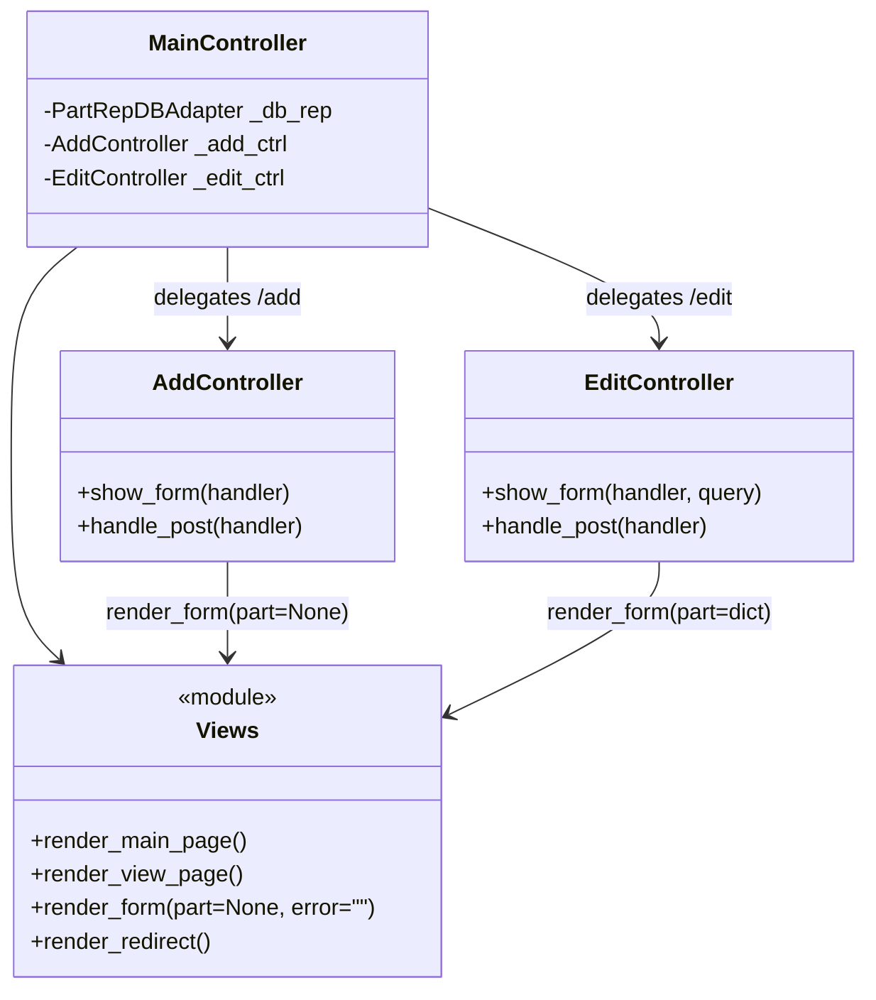
</details>

<details>
<summary><b>Пункт 5: Удаление</b> (нажмите, чтобы развернуть)</summary>

<br>
Для удаления записи создан отдельный `DeleteController`. Это позволяет разгрузить главный контроллер и сохранить принцип единственной ответственности (SRP). Удаление происходит по ID, полученному из GET-параметра.

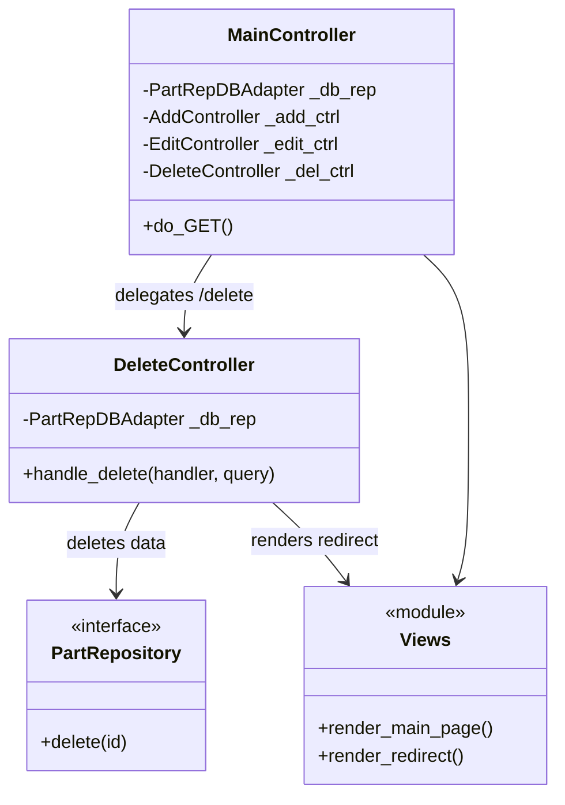
</details>

<details>
<summary><b>Пункт 6 и 7: Фильтрация и Сортировка (Декоратор)</b> (нажмите, чтобы развернуть)</summary>

<br>
Для фильтрации и сортировки мы переиспользуем паттерн Декоратор из ЛР2. Главный контроллер не фильтрует данные сам: он лишь собирает из GET-параметров словарь `ranges` (`{'id': (min_id, max_id), 'price': (min_price, None)}`) и имя поля сортировки, а затем оборачивает базовый репозиторий БД в `FilterSortDecorator`. Значения границ передаются строками прямо из полей формы и приводятся к числам внутри декоратора.

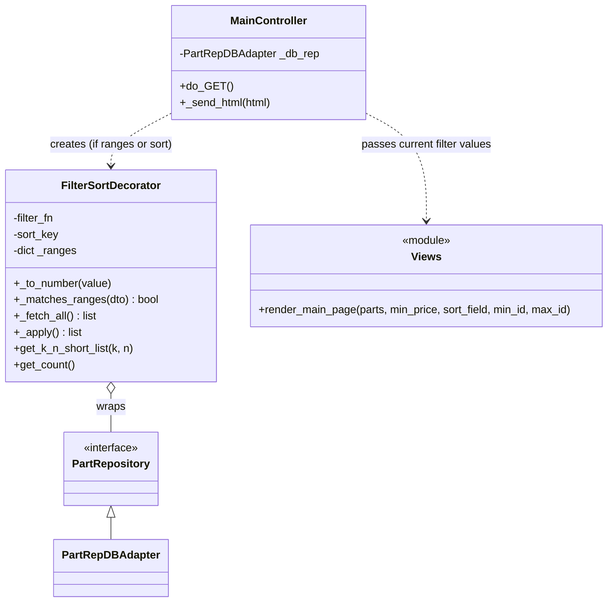

Форма на главной странице (`render_main_page`) содержит поля `min_id`, `max_id`, `min_price` и `sort`; после применения фильтра контроллер передает их текущие значения обратно в шаблон, чтобы пользователь видел активные условия.
</details>

<details>
<summary><b>Пункт 8*: Real-Time Observer + SSE</b> (нажмите, чтобы развернуть)</summary>

<br>
Для реализации real-time обновлений (отслеживания изменений из внешних источников) была построена распределенная архитектура на базе паттернов Observer и Pub/Sub.
1. **MySQL:** Триггеры отслеживают изменения в таблице `parts` и обновляют `system_status`.
2. **Watcher (Python Thread):** Фоновый поток опрашивает `system_status`. При изменении вызывает `notify()` на `EventBus`.
3. **EventBus (Singleton):** Шина событий, хранящая очереди подписчиков (`queue.Queue`).
4. **SSE Controller:** Держит соединение с браузером и передает данные в формате `text/event-stream`.

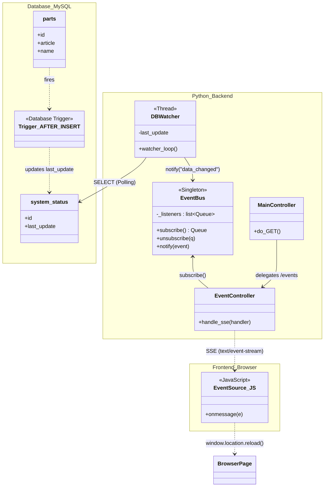
</details>

### Диаграммы последовальности по пунктам:
<details>
<summary><b> Пункт 1: Read / Просмотр </b> (нажмите, чтобы развернуть)</summary>

<br>
Сценарий: Пользователь открывает главную страницу, видит список, затем нажимает "Подробнее" на одной из деталей.

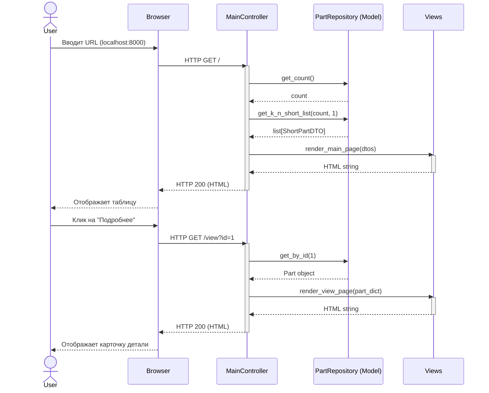
</details>

<details>
<summary><b> Пункт 2: Create / Добавление  </b> (нажмите, чтобы развернуть)</summary>

<br>
Сценарий добавления. Показана работа валидации: если данные не проходят, пользователь остается на форме.

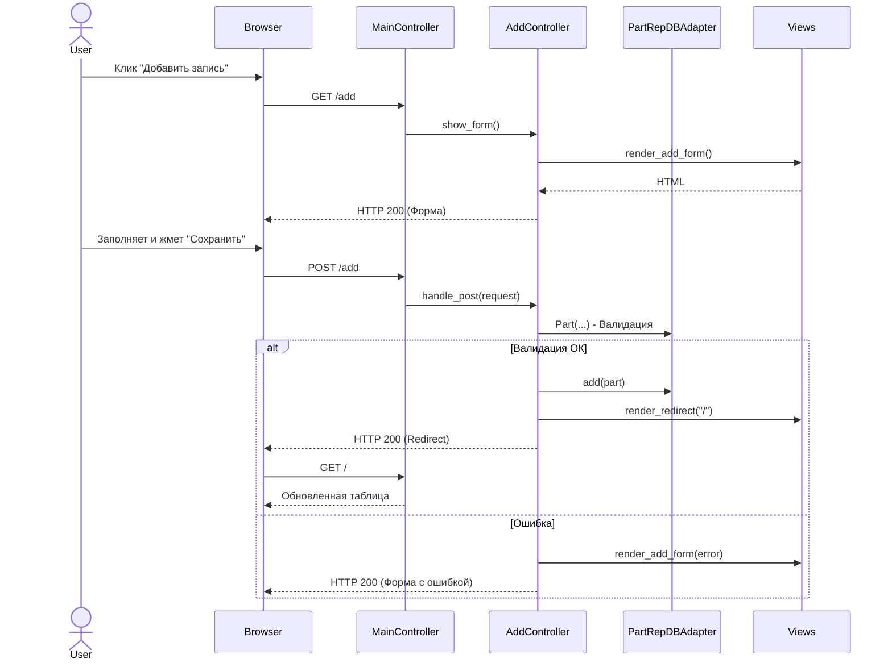
</details>

<details>
<summary><b> Пункт 3: Update / Редактирование</b> (нажмите, чтобы развернуть)</summary>

<br>
Сценарий редактирования. Сначала контроллер загружает данные (GET), затем сохраняет их (POST).

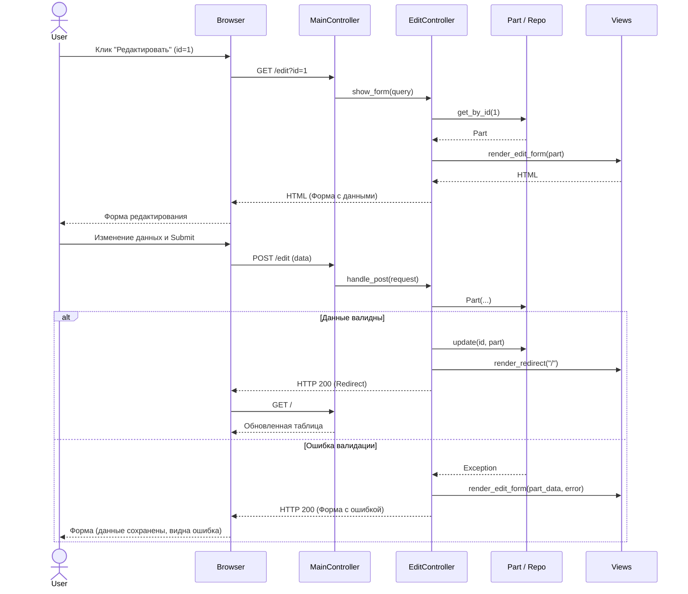
</details>

<details>
<summary><b> Пункт 4: Универсальная форма </b> (нажмите, чтобы развернуть)</summary>

<br>
Сценарий: показываем, как один и тот же `render_form` используется для двух разных сценариев (Add и Edit).

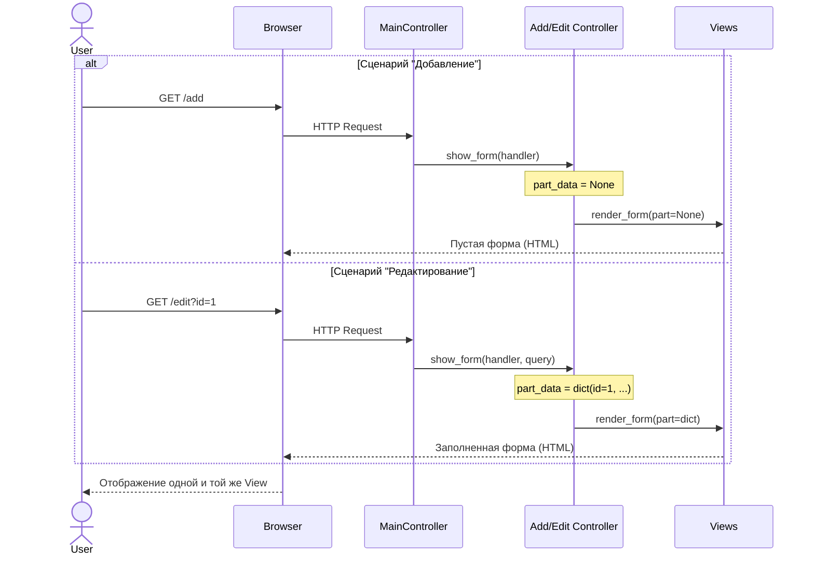
</details>

<details>
<summary><b>Пункт 5: Удаление</b> (нажмите, чтобы развернуть)</summary>

<br>
Сценарий: Пользователь нажимает "Удалить", подтверждает действие во всплывающем окне, запись удаляется из БД, и происходит редирект на обновленную главную страницу.

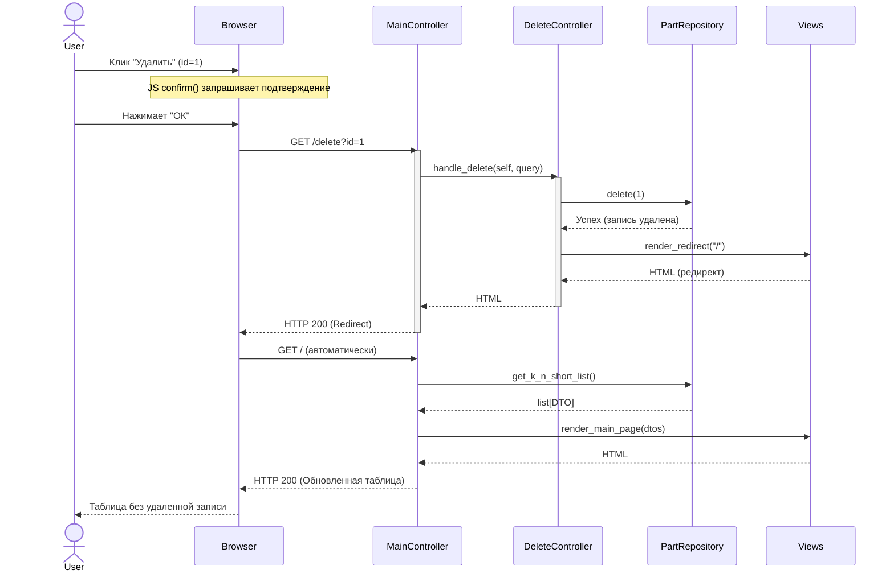
</details>

<details>
<summary><b>Пункты 6 и 7: Фильтрация и Сортировка</b> (нажмите, чтобы развернуть)</summary>

<br>
Сценарий: пользователь задает диапазоны в форме главной страницы («ID от / до», «Цена от») и выбирает поле сортировки. Контроллер превращает параметры в `ranges` и передает их декоратору; сам декоратор приводит границы к числам, отсекает записи вне диапазона и сортирует результат.

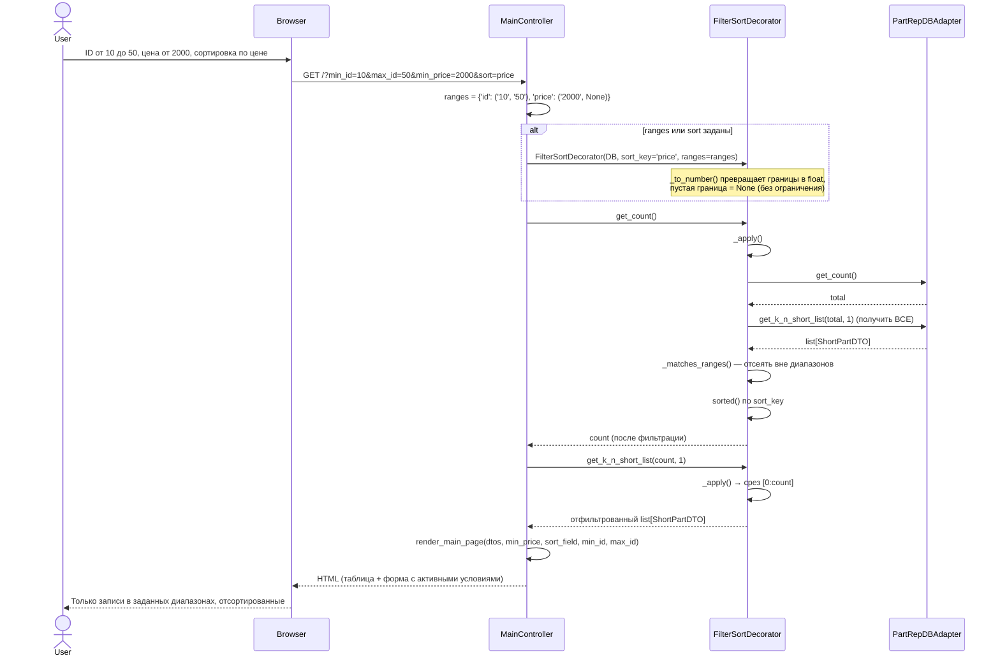

Если пользователь ввел нечисловое значение, `_to_number` выбрасывает `ValueError` с сообщением о некорректном фильтре; пустые поля формы в `ranges` не попадают и выборку не сужают.

</details>

<details>
<summary><b>Пункт 8*: Real-Time Update</b> (нажмите, чтобы развернуть)</summary>

<br>
Сценарий: Внешний скрипт (например, `demo.py`) меняет данные в БД. Веб-сервер узнает об этом и автоматически перезагружает страницу у пользователя.

```mermaid
sequenceDiagram
    actor User
    participant Browser
    participant SSE_Ctrl as EventController
    participant Bus as EventBus
    participant Watcher as DBWatcher (Thread)
    participant DB as MySQL Database
    participant External as demo.py (External)

    %% 1. Установка соединения
    User->>Browser: Открывает страницу
    Browser->>SSE_Ctrl: GET /events
    activate SSE_Ctrl
    SSE_Ctrl->>Bus: subscribe()
    Bus-->>SSE_Ctrl: Queue
    Note over SSE_Ctrl: Соединение удерживается открытым (SSE)

    %% 2. Фоновый процесс
    loop Каждые 2 секунды
        Watcher->>DB: SELECT last_update FROM system_status
        DB-->>Watcher: timestamp
    end

    %% 3. Внешнее изменение
    External->>DB: INSERT INTO parts (...)
    activate DB
    DB->>DB: Trigger AFTER INSERT
    DB->>DB: UPDATE system_status SET last_update = NOW()
    deactivate DB

    %% 4. Обнаружение изменения
    Watcher->>DB: SELECT last_update FROM system_status
    DB-->>Watcher: NEW timestamp!
    Watcher->>Bus: notify("data_changed")
    activate Bus
    Bus->>SSE_Ctrl: queue.put("data_changed")
    deactivate Bus

    %% 5. Отправка в браузер
    SSE_Ctrl->>Browser: data: {"type": "data_changed"}
    deactivate SSE_Ctrl
    
    %% 6. Обновление UI
    Note over Browser: JS EventSource ловит сообщение
    Browser->>Browser: window.location.reload()
    Browser->>User: Страница обновилась (новая деталь в таблице)
```
</details>