# Лабораторные работы №1 и №2 — Архитектура проекта

Данный документ содержит полную архитектуру проекта, разделенную по лабораторным работам и логическим веткам. Нажмите на название диаграммы, чтобы раскрыть её.

<b>🌟 ОБЩАЯ АРХИТЕКТУРА ПРОЕКТА (ЛР1 + ЛР2)</b> (нажмите, чтобы развернуть)

 
Здесь представлена полная картина взаимодействия всех компонентов. Видно, как доменная сущность `Part` (ЛР1) отделена от слоя хранения данных (`PartRepository`). Паттерн `Composite` связывает несколько хранилищ вместе, а `Decorator` позволяет динамически фильтровать данные.

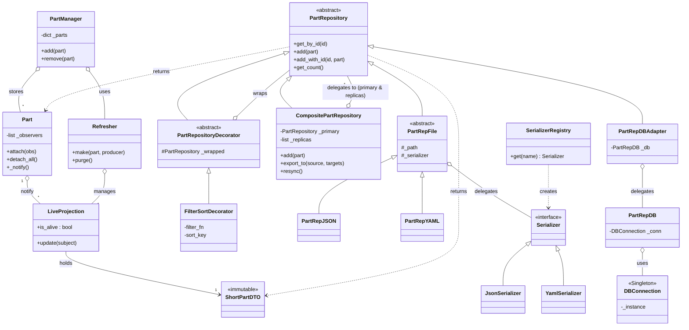

## Лабораторная работа №1 (Домен и Observer)

<b>1. Ядро: Домен и живые проекции (Observer)</b> (нажмите, чтобы развернуть)

 
На этой диаграмме видно, как `Part` (Subject) уведомляет `LiveProjection` (Observer) об изменениях, а `Refresher` управляет их жизненным циклом.

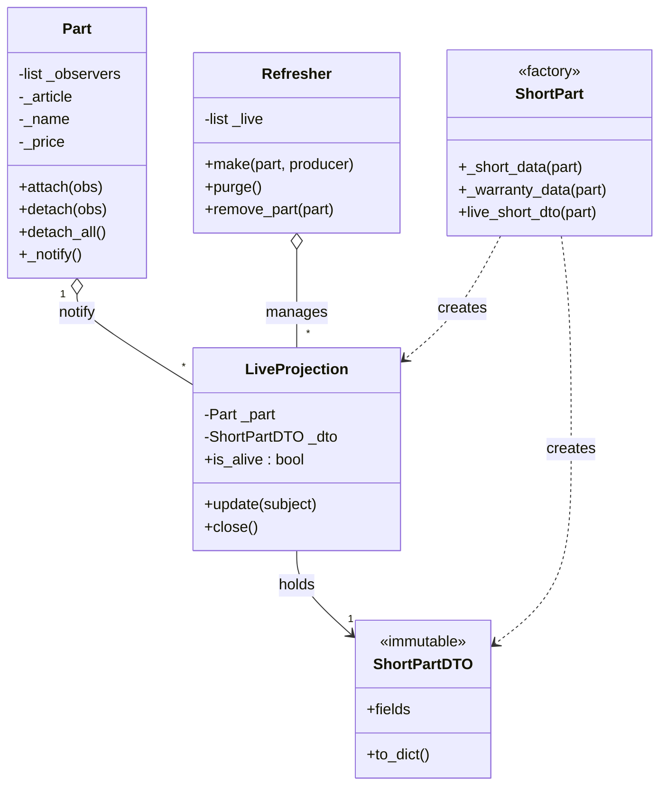

<b>2. Вспомогательные ветки: Парсеры и Менеджер</b> (нажмите, чтобы развернуть)

 
Инструменты для создания объекта из разных форматов и in-memory репозиторий для демонстрации.

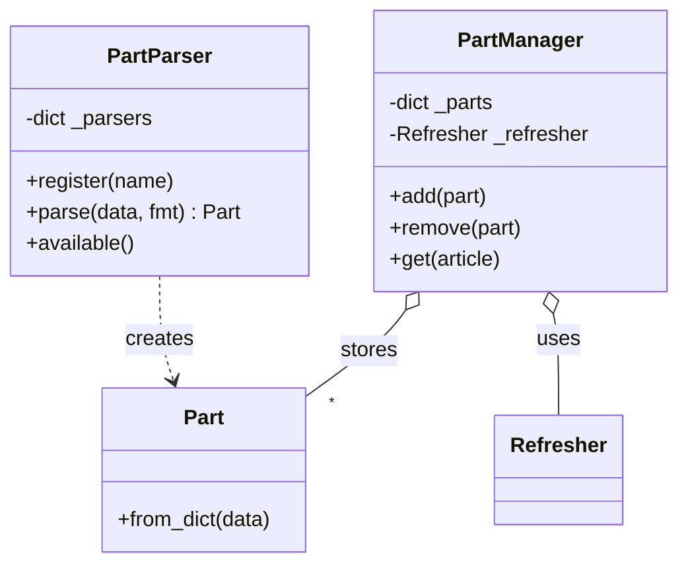

## Лабораторная работа №2 (Репозитории)

<b>1. Ветка работы с файлами (Стратегия и Реестр)</b> (нажмите, чтобы развернуть)

 
Показывает, как решается проблема дублирования кода между JSON и YAML. Вся логика в базовом `PartRepFile`, а формат вынесен в стратегии `Serializer`.

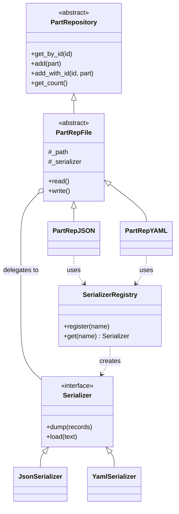

<b>2. Ветка работы с БД (Синглтон и Адаптер)</b> (нажмите, чтобы развернуть)

 
`DBConnection` (Синглтон) управляет единственным соединением. `PartRepDBAdapter` (Адаптер) встраивает SQL-репозиторий в общую иерархию.

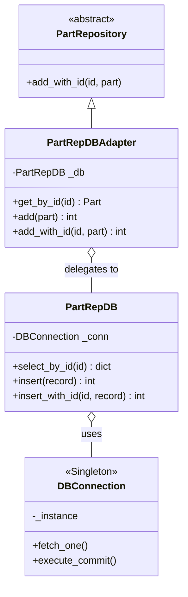

<b>3. Ветка Декораторов (Фильтр и Сортировка)</b> (нажмите, чтобы развернуть)

 
Паттерн Декоратор позволяет добавить фильтрацию и сортировку поверх любого репозитория, не меняя код самого репозитория.

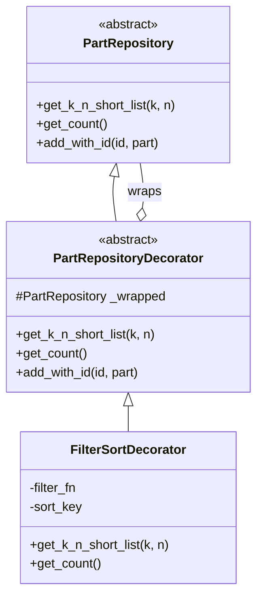

<b>4. Ветка Компоновщика (Синхронизация хранилищ)</b> (нажмите, чтобы развернуть)

 
Паттерн Компоновщик (Composite) позволяет работать с группой репозиториев как с единым целым. В данном случае он берет ID из Primary (БД) и синхронизирует данные с репликами (файлами JSON/YAML).

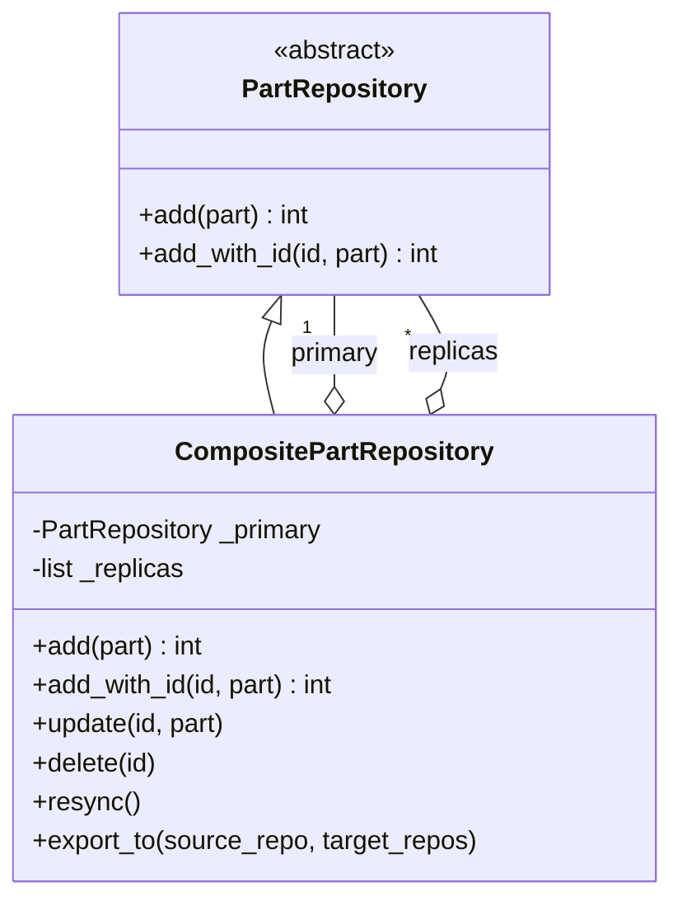

## Лабораторная работа №3 (MVC и Observer)</b>

### Диаграммы классов по пунктам:

<b> Пункт 1: Базовый MVC + Read</b> (нажмите, чтобы развернуть)

 
На этой диаграмме показано разделение ответственности по паттерну MVC. Контроллер обрабатывает HTTP-запросы и связывает Представление (HTML-шаблоны) с Моделью (Репозиториями). Паттерн Наблюдатель используется на стороне Модели (через `Refresher`) для синхронизации данных.

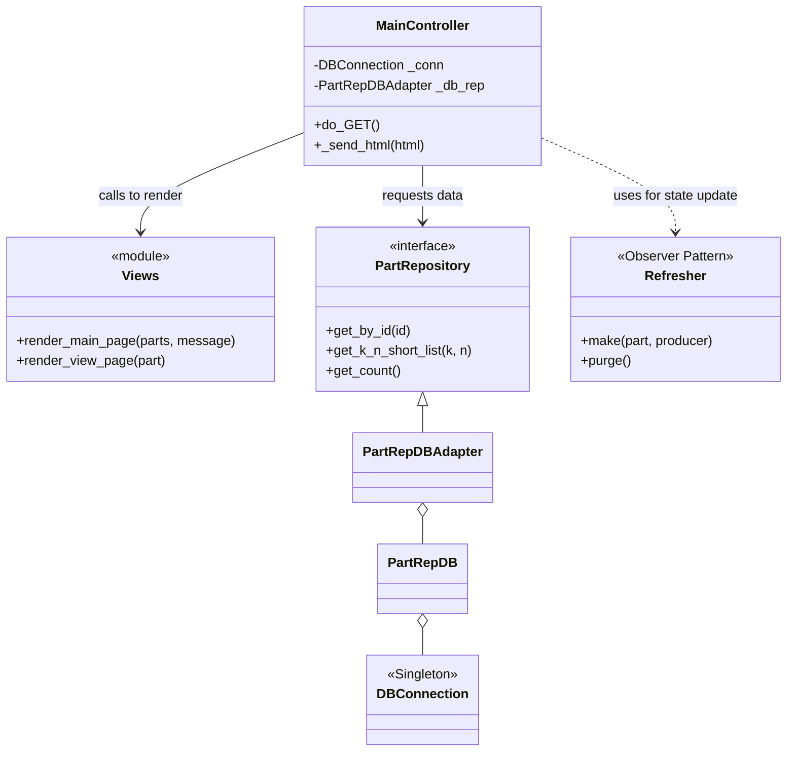

<b> Пункт 2: Добавление записи</b> (нажмите, чтобы развернуть)

 
Для выполнения требования "для нового окна — новый контроллер" мы выделили `AddController`. Главный контроллер делегирует ему обработку маршрута `/add`.

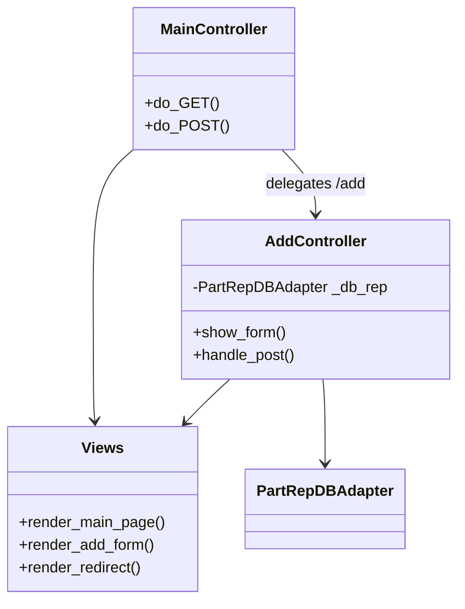

<b> Пункт 3: Редактирование</b> (нажмите, чтобы развернуть)

 
По аналогии с добавлением создан `EditController`. Теперь `MainController` выступает как маршрутизатор, который передает управление нужному контроллеру в зависимости от URL.

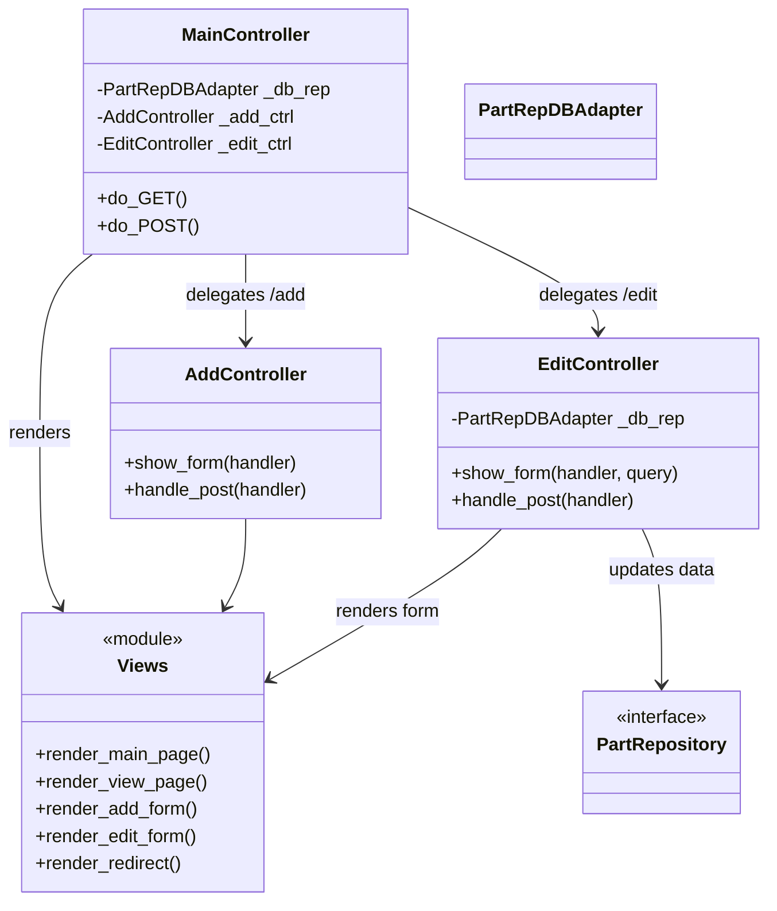

<b> Пункт 4: Универсальная форма</b> (нажмите, чтобы развернуть)

 
Рефакторинг: вместо двух разных View-функций для добавления и редактирования, создана одна универсальная `render_form`. Различие в поведении (пустая/заполненная форма) теперь полностью контролируется контроллерами.

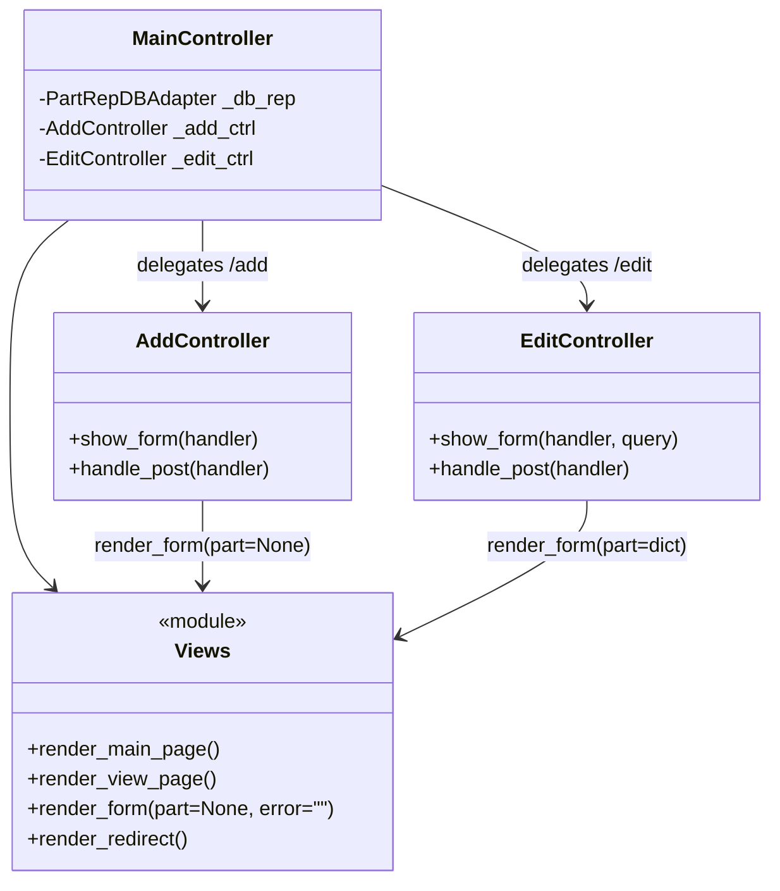

### Диаграммы последовальности по пунктам:

<b> Пункт 1: Read / Просмотр </b> (нажмите, чтобы развернуть)

 
Сценарий: Пользователь открывает главную страницу, видит список, затем нажимает "Подробнее" на одной из деталей.

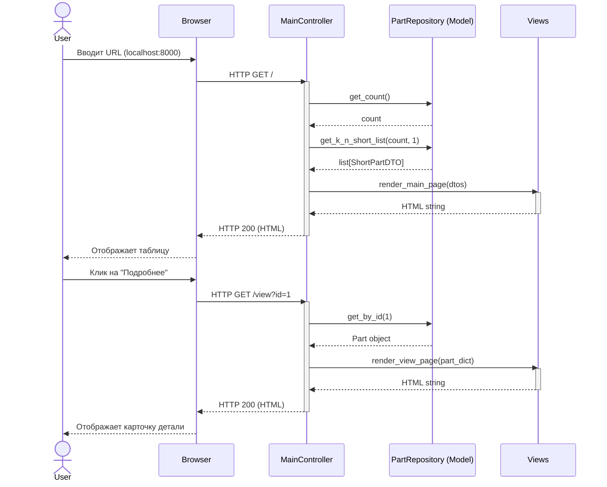

<b> Пункт 2: Create / Добавление  </b> (нажмите, чтобы развернуть)

 
Сценарий добавления. Показана работа валидации: если данные не проходят, пользователь остается на форме.

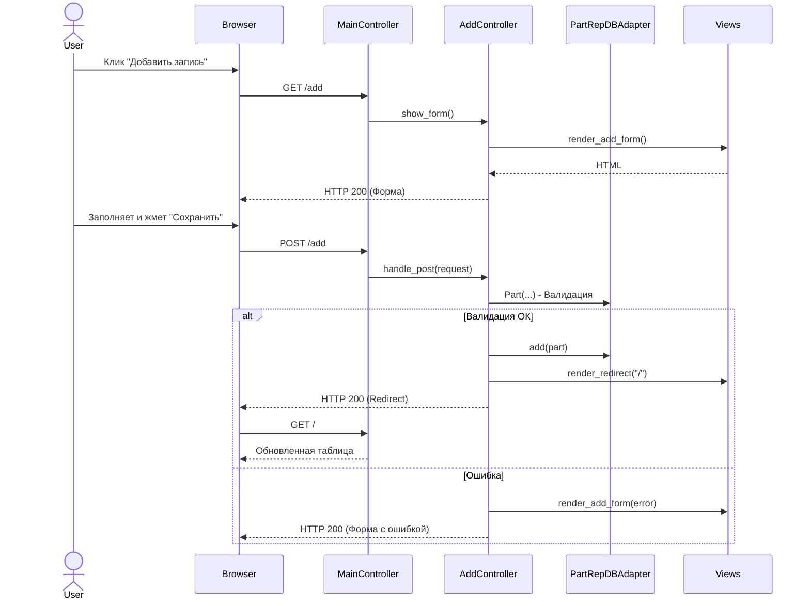

<b> Пункт 3: Update / Редактирование</b> (нажмите, чтобы развернуть)

 
Сценарий редактирования. Сначала контроллер загружает данные (GET), затем сохраняет их (POST).

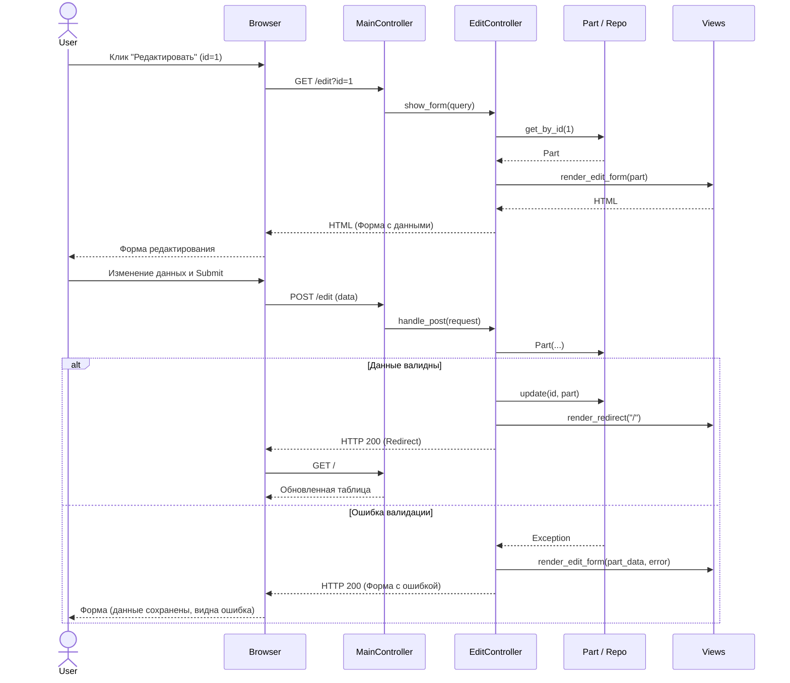

<b> Пункт 4: Универсальная форма </b> (нажмите, чтобы развернуть)

 
Сценарий: показываем, как один и тот же `render_form` используется для двух разных сценариев (Add и Edit).

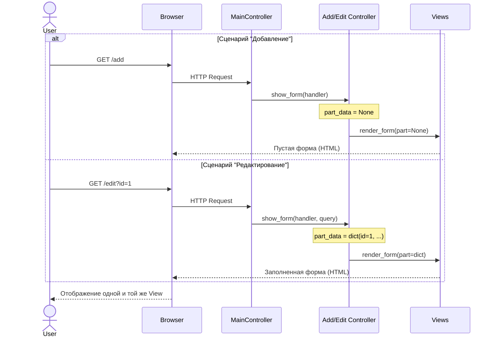

